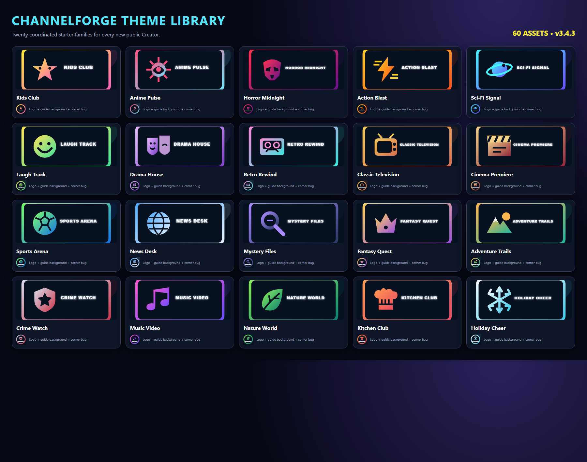

# Public ChannelForge 3

Public ChannelForge is a standalone, local-first live TV server for local media folders, Plex libraries, or both. It runs continuously in the background, maintains deterministic 24/7 channel schedules, and hosts XMLTV, M3U, and browser-compatible HLS endpoints. Plex and ErsatzTV are optional.

## ChannelForge TV ecosystem

Version 3.2 adds three public components without changing the owner's private ChannelForge build:

- **Hosted Creator Directory** — creators explicitly publish their public XMLTV/M3U endpoints. An edge health check temporarily hides offline studios and restores them automatically.
- **ChannelForge TV for Fire TV / Android TV** — downloadable remote-first APK with creator browsing, channel surfing, HLS playback, and a full-screen guide HUD.
- **ChannelForge TV for Roku** — native SceneGraph/BrightScript channel with the same directory, channel surfing, guide, and HLS playback model.

Publishing is activated with **Go live worldwide** in Creator. The Windows build opens an outbound encrypted Cloudflare tunnel automatically, registers the temporary HTTPS address with the global directory, and refreshes it after Creator restarts. Viewers never enter an IP address or configure the creator's router. The directory never receives Plex credentials, local filesystem paths, media databases, or video files; it stores only public studio metadata and ChannelForge endpoints.

Viewers never need Plex: ChannelForge TV talks only to the creator's published ChannelForge HTTPS endpoint. Plex is an optional source used privately by ChannelForge Creator. The Creator application must remain running while its channels are online. The global directory deploys automatically from `main` when its Cloudflare repository secrets are configured. Fire TV also includes Retry and Pair Creator controls: a viewer can enter the HTTPS pairing URL shown in Creator's **Publish worldwide** panel when the directory is unavailable.

Source and deployment instructions are in [`directory/`](directory/), [`tv/firetv/`](tv/firetv/), and [`tv/roku/`](tv/roku/). Tagged releases build the installable Fire TV APK and Roku ZIP automatically.

Version 3 introduces the studio workspace inspired by the private ChannelForge manager: a fixed sidebar and status bar, overview metrics and live lineup, dedicated searchable poster library, draggable channel ordering, a four-step channel builder, expanded ordered/shuffle/marathon/franchise modes, branding and guide-artwork workspaces, system health cards, and automatic credential-free configuration backups. Private artwork, private APIs, Fish Audio, and ErsatzTV-specific operations are intentionally not copied.

The built-in **Watch TV** screen includes an embedded HLS player, channel rail, now-playing progress, and six-hour visual guide. Viewers click a channel and watch immediately in ChannelForge without adding it to Plex DVR.

Playback is source-aware and demand driven. Local-library and Plex titles use ChannelForge's bundled FFmpeg H.264/AAC HLS pipeline only while a viewer is actively watching. Plex credentials stay inside Creator, browser/device-safe video is produced consistently on Windows and Linux, and idle sessions are stopped automatically. Local-only users do not need a Plex account or server.

The **Get Started** screen walks new users through adding a local folder or connecting Plex, creating a channel, testing it in the player, and copying the hosted stream URLs.

Completed setup tasks show a visible check mark. Channels can be deleted either from the Channels manager or directly from the Watch TV channel rail.

After connection, ChannelForge displays the Plex username, server name, and server version supplied by that server. Library browsing includes Plex posters, summaries, ratings, years, and media types. Poster bytes are proxied through ChannelForge so the Plex token is never placed in browser image URLs.

Channel creation also discovers Plex servers that other Plex users have explicitly shared with the signed-in account. Shared libraries are labeled with the server owner's name and can be selected exactly like the user's own libraries; selecting a show still adds the complete series. ChannelForge uses the per-server access granted by Plex only while browsing or playing a selected title. Shared-server tokens stay inside Creator, are excluded from channels and exports, and are never sent to ChannelForge TV or the public directory. Libraries that have not been shared through Plex are not visible.

The built-in **Asset Studio** creates original channel logos, guide backgrounds, and corner bugs from a channel name and user-selected colors. Users can also upload artwork they own and assign a logo to an XMLTV channel. Artwork remains in the user's local application-data folder.

Every installation includes 60 coordinated starter assets: a logo, guide/player background, and corner bug for each of 20 original themes. The collection covers Kids, Anime, Horror, Action, Sci-Fi, Comedy, Drama, Retro, Classic Television, Cinema, Sports, News, Mystery, Fantasy, Adventure, Crime, Music, Nature, Kitchen, and Holiday channels. Each family has its own illustrated symbol and color language rather than a text-only placeholder. Built-ins refresh during upgrades without replacing user-created or uploaded artwork.



All ChannelForge apps expose an update control backed by the official GitHub Releases feed. Creator and desktop TV check on launch, notify immediately, show download progress, and verify the published SHA-256 checksum before offering the update. After the user confirms, an installed Windows app performs an in-place update and restarts without reopening the first-install setup wizard; the chosen install folder, shortcuts, configuration, channels, and artwork are preserved. Fire TV detects the release and opens the exact official APK download; Android still requires the user to approve its package-installer prompt. Roku reports release availability in-app; Roku Store installs update automatically when distributed through the Store, while developer/sideload builds must be replaced through Roku's developer installer. Linux users receive the verified Debian, Arch/Omarchy, or portable package and a copyable install command. ChannelForge never downloads or launches an update without confirmation.

ChannelForge v3.5.3 fixes studio recovery after Creator restarts: republishing reactivates an offline directory entry and desktop, Fire TV, and Roku viewers refresh the public catalog automatically. Releases are now published atomically only after the Windows suite, Linux/Omarchy packages, Fire TV APK, Roku channel, and checksum files all finish, preventing the “missing checksum” update failure. The portable Linux installer now resolves both extracted archives and source checkouts correctly. It includes all v3.5.2 Smart Channel, English-audio, low-latency playback, Rewind Cinema filtering, remote-friendly TV UI, and cross-platform installer improvements.

Demo previews (real installations replace these sample studios and posters with published creator data):


This repository is the sanitized public edition. It contains **no private API credentials, Plex tokens, personal channel presets, media databases, logs, backups, or custom artwork** from the original ChannelForge installation.

The interface and asset workflow remain part of ChannelForge. Only the original owner's private Fish Audio integration and personal channel assets/presets are excluded. This public edition does not contact Fish Audio or ship any Fish API code.

## Windows installation

1. Download `ChannelForge_Setup.exe` from the latest GitHub Release.
2. Run it and choose one install folder, Desktop shortcuts, and the optional Creator startup shortcut.
3. Setup installs `ChannelForge_Creator.exe` and `ChannelForge_TV.exe` side by side in that folder and creates separate branded Desktop and Start Menu shortcuts for both applications.
4. `ChannelForge_Creator.exe` opens as a dedicated desktop application window and starts its TV server at `http://127.0.0.1:8787` inside the same process.
5. On first launch, choose **Add a local media folder**, **Sign in with Plex**, or configure both.
6. Open **Channels**, create a channel, choose any configured library, and select movies or entire TV shows. Selecting a show adds every playable episode in season/episode order.
7. Open **Guide exports** to copy the hosted XMLTV and M3U URLs into your DVR, tuner client, or IPTV player.
8. Open **Setup** and select **Go live worldwide** to make the studio appear in every ChannelForge TV app. Creator must remain open while viewers watch.

Leave ChannelForge Creator running while viewers use its channels. It hosts the XMLTV guide, M3U playlist, artwork, and on-demand HLS streams. `ChannelForge_TV.exe` is a separate native-window viewer for watching published studios and does not open the default browser.

`ChannelForge_TV.exe` remains available as a portable viewer-only alternative. The Fire TV APK and Roku ZIP also remain standalone viewers and never install Creator. Both Windows applications place their dedicated icon beside the executable and explicitly use it for Desktop, Start Menu, and Creator startup shortcuts, avoiding stale Windows icon-cache artwork. Product-specific setup aliases remain in releases only so older in-app updaters continue to work; all interactive Windows setup packages install the same two-app suite.

On Windows, closing the Creator window minimizes it to the notification area so hosting continues. The first close displays a reminder. Use the tray icon to reopen ChannelForge Creator or choose **Exit and stop channels** to shut down XMLTV, M3U, and playback hosting.

The setup wizard and installed executables use separate ChannelForge Creator and ChannelForge TV icons. The setup wizard includes a dark ChannelForge banner instead of the default plain white Tk appearance.

Windows may show a SmartScreen warning because community builds are not code-signed. Verify the SHA-256 checksum shown in the GitHub release before running the installer.

## Linux, Arch Linux, and Omarchy

Requirements: Python 3.10 or newer, FFmpeg, and PyWebView. Every Linux package installs both native desktop applications: ChannelForge Creator and ChannelForge TV. Debian and Arch packages declare the required media and desktop runtimes; the portable installer shows the exact distro command if one is missing.

### Debian, Ubuntu, Mint, and similar distributions

Download the `.deb` file from the latest release, then run:

```bash
sudo apt install ./Public_ChannelForge-*-linux-all.deb
public-channelforge
channelforge-tv
```

### Arch Linux and Omarchy

Download the `.pkg.tar.zst` file from the latest release, then run:

```bash
sudo pacman -U ./public-channelforge-*-any.pkg.tar.zst
public-channelforge
channelforge-tv
```

### Universal Linux user installation

Download and extract the `ChannelForge-*-linux-x64.tar.gz` archive, open its `ChannelForge` directory, and run:

```bash
chmod +x install.sh uninstall.sh
./install.sh
public-channelforge
channelforge-tv
```

Developers can alternatively clone the repository:

```bash
git clone https://github.com/dethkorex/Public_ChannelForge.git
cd Public_ChannelForge
chmod +x scripts/install_linux.sh scripts/uninstall_linux.sh
./scripts/install_linux.sh
public-channelforge
channelforge-tv
```

On Arch Linux or Omarchy, install prerequisites if needed:

```bash
sudo pacman -S --needed python git ffmpeg python-pywebview python-gobject webkit2gtk-4.1
```

If `public-channelforge` is not found, add this to `~/.bashrc` or `~/.zshrc`, then open a new terminal:

```bash
export PATH="$HOME/.local/bin:$PATH"
```

The app uses XDG paths on Linux:

- App files: `~/.local/share/public-channelforge/app`
- User settings and token: `~/.config/public-channelforge`
- Creator launcher: `~/.local/share/applications/public-channelforge.desktop`
- TV launcher: `~/.local/share/applications/channelforge-tv.desktop`

Both apps open in dedicated PyWebView windows. Plex account approval opens in the system browser on Linux for compatibility, then Creator detects the approved PIN automatically.

## Local-folder setup

- Open **System** → **Media sources**, enter a friendly library name, and provide the absolute path to an existing folder.
- ChannelForge scans that folder recursively for MKV, MP4, M4V, AVI, MOV, WebM, TS, M2TS, MPEG, WMV, and FLV video files.
- Add `poster.jpg`, `folder.jpg`, or an image with the same filename as a video to display local artwork.
- The folder must remain available while its channels are playing. Removing a source never deletes the user's media.
- Saved paths are validated before playback; ChannelForge will only open video files inside configured local-library roots.

## Optional Plex setup details

- **Sign in with Plex** uses Plex's official PIN authorization page, never asks ChannelForge for your password, automatically receives the account token after approval, and discovers the best available Plex Media Server connection.
- Manual setup remains available from the onboarding screen for unusual network layouts or servers that Plex discovery cannot reach.
- Use the URL that is reachable from the same computer, such as `http://127.0.0.1:32400` or `http://192.168.1.20:32400`.
- To configure Plex automatically: in Plex Web, open a media item, select **Get Info** → **View XML**, copy the complete URL, and paste it into ChannelForge. The app extracts `X-Plex-Token`, securely stores it locally, and removes it from the visible server URL. Manual token entry remains available.
- The token is written only to the current user's configuration directory. It is never sent anywhere except the configured Plex server.
- Public ChannelForge binds to localhost by default, so other devices cannot access the dashboard unless a user deliberately adds their own proxy/network configuration.

## Standalone server and live playback

ChannelForge owns the channel clock and guide. Every channel has a stable schedule anchor; restarting the application does not reset the lineup to its first title. The XMLTV includes current and upcoming programs using probed local-file or Plex duration metadata. The M3U points to ChannelForge's `/live/<channel>.m3u8` URLs. When a player opens one, ChannelForge resolves the current program and offset, then creates an HLS session for that exact live position.

Local folders and Plex can be used independently or together. Local files use the bundled FFmpeg encoder. Plex titles use Plex's authenticated universal HLS endpoint through ChannelForge's same-origin proxy, preventing browser CORS failures and avoiding an unnecessary second transcode on the Creator computer. Playback errors shown in the player are retrieved from the server and scrubbed of Plex tokens.

## Channel playback modes

- **Play in order** repeats selected movies or episodes in their selected order.
- **Shuffle lineup** creates a deterministic mixed order that remains stable across application restarts.
- **Series marathon** shuffles the selected series order while preserving season and episode order inside each series.

For Plex TV libraries, ChannelForge loads playable episode records rather than show folders. The channel editor includes title filtering, Select all, and Clear controls for large libraries.

For clients on another device, choose **Local network** in Setup, enter a base URL such as `http://192.168.1.50:8787`, save, and restart ChannelForge. Only expose this server on a trusted home network; it has no internet-facing authentication.

## Community tools

See [PLUGIN_DEVELOPMENT.md](PLUGIN_DEVELOPMENT.md). Tools execute as local Python code and should only be installed from trusted authors.

## Build the Windows installer

From PowerShell on Windows:

```powershell
./scripts/build_windows.ps1
```

The script installs the pinned build dependencies and creates `release/ChannelForge_Creator_Setup.exe`, `release/ChannelForge_TV_Setup.exe`, and the portable `release/ChannelForge_TV.exe` plus SHA-256 checksums. Both installers are per-user, allow the destination folder to be selected, and do not require administrator rights.

## Developer run and tests

```bash
python Public_ChannelForge.py
python -m unittest discover -s tests -v
```

## Uninstall

Windows: remove the installation folder and its shortcuts. User configuration is stored separately under `%LOCALAPPDATA%\Public_ChannelForge` so upgrades do not erase it.

Linux:

```bash
./scripts/uninstall_linux.sh
```

The Linux uninstaller keeps user settings. Remove `~/.config/public-channelforge` manually only if you also want to erase the saved Plex token and channel definitions.

## License and trademarks

MIT licensed. Plex is a trademark of Plex, Inc. This project is an independent community tool and is not affiliated with or endorsed by Plex.

